# Financial Risk Multi-Agent Architecture

This diagram represents the current end-to-end system. It distinguishes raw
data, processed features, specialist inference, reliability controls, and the
customer-facing application.

```mermaid
flowchart LR
    %% External data sources
    subgraph SOURCES[External Data Sources]
        Y[Yahoo Finance<br/>OHLCV and price history]
        S[SEC EDGAR<br/>company facts and filings]
        F[FRED API<br/>macro observations]
        N[NewsAPI<br/>financial headlines]
    end

    %% Medallion data platform
    subgraph DATA[Medallion Data Platform]
        B[Bronze<br/>immutable raw CSV/JSON<br/>source snapshots]
        CL[Silver Cleaning and Validation<br/>standardized dates, schemas,<br/>duplicates, missing values]
        SI[Silver<br/>clean CSV and Parquet<br/>validated agent inputs]
        G[Gold Feature and Risk Layer<br/>company features, risk scores,<br/>freshness and priority metadata]
    end

    Y --> B
    S --> B
    F --> B
    N --> B
    B --> CL --> SI --> G

    %% Retrieval and knowledge
    subgraph KNOWLEDGE[Evidence and RAG]
        VR[Vector Retrieval<br/>ticker-filtered Silver/Gold evidence]
        FT[Financial Terms RAG<br/>definitions, formulas, thresholds,<br/>priority rules]
    end

    SI --> VR
    G --> VR
    FT --> RAG[Agent-specific RAG Context]
    VR --> RAG

    %% Agents
    subgraph AGENTS[Specialist Agents]
        FD[Fundamental Agent<br/>Fine-tuned FinBERT<br/>SEC evidence]
        MV[Market and Volatility Agent<br/>Mistral 7B LoRA candidate<br/>Qwen LoRA active configuration<br/>rule fallback]
        SA[Sentiment Agent<br/>ProsusAI FinBERT<br/>NewsAPI headlines<br/>VADER/no-news fallback]
        MA[Macro Agent<br/>Phi-4-mini Macro v2 LoRA<br/>FRED rule fallback]
    end

    RAG --> FD
    RAG --> MV
    RAG --> SA
    RAG --> MA
    SI --> FD
    SI --> MV
    SI --> SA
    SI --> MA
    G --> FD
    G --> MV
    G --> SA
    G --> MA

    %% Reliability and debate
    subgraph CONTROL[Reliability and Debate Control]
        SH[Self-Healing<br/>invalid output, timeout,<br/>low confidence, missing evidence<br/>maximum one retry]
        DC[Contradiction Detection<br/>label disagreement, score spread,<br/>freshness and fallback checks]
        RV[Self-Revision<br/>reassessment request with evidence<br/>maximum two rounds]
        CR[Critic / Orchestrator<br/>Claude when configured<br/>local weighted fallback]
        PG[Review Guardrails<br/>confidence cap, policy A-H evidence,<br/>review_required decision]
    end

    FD --> SH
    MV --> SH
    SA --> SH
    MA --> SH
    SH --> DC
    DC --> RV
    RV --> CR
    DC --> CR
    CR --> PG

    %% Serving layer
    subgraph APP[Application and Operations]
        API[FastAPI<br/>verdict, debate, compare,<br/>prices, monitoring, /docs]
        UI[Risk Console Frontend<br/>question input, scorecards,<br/>charts, contradictions, evidence]
        ART[Artifacts<br/>JSON verdicts, PDFs, reports,<br/>training and evaluation metrics]
        MON[Monitoring and Lineage<br/>MLflow/local JSONL<br/>latency, confidence, retries]
    end

    PG --> API
    API --> UI
    PG --> ART
    PG --> MON
    API --> MON

    classDef source fill:#e8f1ff,stroke:#2563eb,color:#172554
    classDef data fill:#e8f8f5,stroke:#0f766e,color:#134e4a
    classDef rag fill:#f5edff,stroke:#7c3aed,color:#3b0764
    classDef agent fill:#fff4df,stroke:#d97706,color:#78350f
    classDef control fill:#ffe8e8,stroke:#dc2626,color:#7f1d1d
    classDef app fill:#edf2f7,stroke:#334155,color:#0f172a

    class Y,S,F,N source
    class B,CL,SI,G data
    class VR,FT,RAG rag
    class FD,MV,SA,MA agent
    class SH,DC,RV,CR,PG control
    class API,UI,ART,MON app
```



## Runtime Sequence

1. Yahoo Finance, SEC EDGAR, FRED, and NewsAPI data are captured in Bronze.
2. Cleaning and validation produce Silver CSV and Parquet inputs.
3. Gold features, risk fields, freshness, and priority metadata are generated.
4. Ticker-specific evidence and curated financial rules are retrieved through
   RAG.
5. The four specialist agents produce structured scores, labels, confidence,
   and evidence.
6. Self-healing retries malformed, unavailable, or low-confidence outputs once.
7. Contradictions are detected and affected agents receive bounded revision
   requests for up to two rounds.
8. The critic synthesizes the final verdict and review guardrails are applied.
9. FastAPI serves the verdict to the Risk Console and stores JSON/PDF/report
   artifacts plus monitoring metadata.

## Model Configuration Note

The architecture supports the trained Mistral 7B market adapter, but the active
model is controlled by `.env`. The production diagram should be read together
with the runtime configuration:

```env
MARKET_LORA_BASE_MODEL=...
MARKET_LORA_ADAPTER_DIR=...
MARKET_LORA_REMOTE_URL=...
```

When the remote Qwen endpoint is configured, the market agent uses that
endpoint. When it is cleared and the base model/adapter point to Mistral, the
local Mistral adapter is used. Both paths preserve the same structured output
contract and rule-based fallback.

## Trust Boundaries

- External APIs are untrusted inputs and may be stale, rate-limited, or
  incomplete.
- Bronze is immutable and is never used as silently cleaned evidence.
- Specialist outputs must include structured fields and evidence.
- RAG retrieval is ticker-filtered before it reaches an agent.
- Low confidence, missing news, stale data, fallback claims, and unresolved
  contradictions remain visible to the user.
- The application provides research guidance, not personal financial advice.
